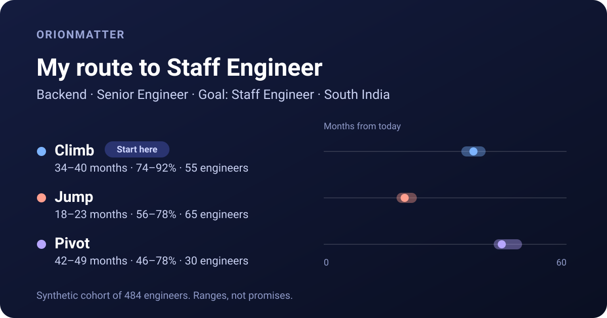
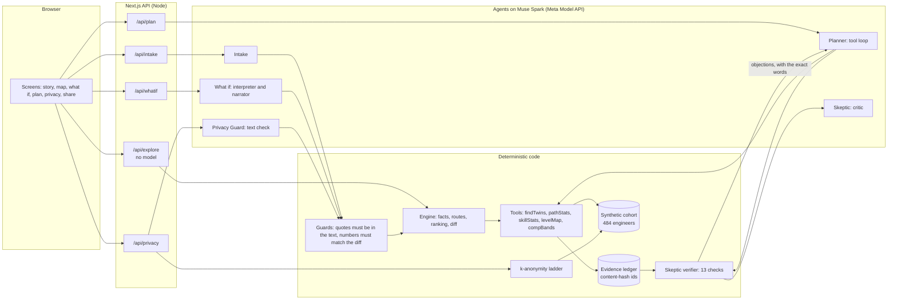

# Orionmatter Path Engine

**A career route planner for engineers that shows its work.** Tell it where you are and where you want to go. It shows three
routes (climb, jump, pivot) as honest ranges, what each is based on, what a skeptical reviewer objected to, what sharing
your story would reveal about you, and what changes if you change your mind.

Built for the Meta Global AI Developer Hackathon (Cerebral Valley), "Build for Your World". Every model call goes
through the **Meta Model API** to **Muse Spark** (`muse-spark-1.3`). Development used **Muse Code**; see
[Built with Muse Code](#built-with-muse-code).

> **Honest by design.** The cohort behind every number is **synthetic** (484 generated engineers). Every figure is a range with
> the number of engineers behind it. Nothing here is a promise, a prediction about you, or a way to screen anyone else: it
> is a planning tool for one person at a time.

|                                                |                                        |
| ---------------------------------------------- | -------------------------------------- |
| Live app                                       | `https://orionmatter.vercel.app/`      |
| Demo app (no key, recorded Muse Spark answers) | `https://orionmatter-demo.vercel.app/` |
| Video                                          | https://youtu.be/J1vx0-ercSA           |





_Both pictures are drawn by the app's own components from the recorded demo data (`npm run docs:images`), not mocked up._

## Why this exists

Career advice from a chatbot is fluent and unaccountable: it can say "Staff in 18 months" and nothing checks it. A
person deciding whether to switch jobs, retrain or wait needs the opposite: how many comparable people made it, how long it
usually took, how sure we are, and what is simply unknown. They also have to hand over details about themselves to get
that answer, and nobody tells them how identifying those details are.

Orionmatter is built on one rule: **the model writes and explains; code owns every number and every verdict.**

## What you can do

| Tab            | What it does                                                                                                                   | Who does the work                                                           |
| -------------- | ------------------------------------------------------------------------------------------------------------------------------ | --------------------------------------------------------------------------- |
| **Your story** | Type a few lines or upload a cropped screenshot; get an editable form that says where each field came from                     | Muse Spark reads, code validates every field against your own words         |
| **Map**        | Three routes as a constellation on a time axis, with ranges, sample sizes, and a "limited evidence" state                      | Code only                                                                   |
| **What if**    | Drag limits (time, pay, remote, relocation, risk, skills) or say it in a sentence; see what moved and which limit matters most | Sliders: code only. Sentences: Muse Spark reads and explains, code computes |
| **Plan**       | Full plan with steps and evidence, and a live **Agent trace** of the Planner and the Skeptic                                   | Muse Spark plans, the Skeptic checks every figure                           |
| **Compare**    | Radar and table of the three routes                                                                                            | Code only                                                                   |
| **Privacy**    | How big a crowd you hide in as you share role, level, goal, region; check a text you plan to post                              | Code counts, Muse Spark proposes details, code verifies each quote          |
| **Share**      | A card of your three routes that shows only what keeps you in a crowd of at least k                                            | Code only, made in your browser                                             |
| **Why**        | How to read the numbers, and what they cannot tell you                                                                         |                                                                             |

## How it works



1. **Tools compute, with receipts.** Every number comes from a tool run against the cohort and is recorded in an _evidence
   ledger_ under an id that is a hash of the call. The model never invents a figure; it cites ids.
2. **The Planner (Muse Spark)** chooses which lookups to make through a tool loop, then composes three routes, each claim citing
   evidence ids. If it skips a lookup, code fills it in and the trace says so.
3. **The Skeptic checks, twice.** A deterministic **verifier** rejects a claim whose evidence is missing, belongs to another route,
   has a different sample size, quotes a range no evidence supports, uses a number found in no evidence, promises an outcome, or
   leaves out the "limited evidence" or survivorship wording (13 finding codes). A model-based **critic** then looks for
   what code cannot see. The Planner revises. A plan that is still rejected after the revisions is shown as **unresolved**,
   never dressed up.
4. **What if** turns a sentence into limit changes. Every proposed change must quote the person's own words, anything the data cannot represent
   ("a 4-day week") is listed as not modelled, vague requests become a question, and contradictions are not applied. The recomputation is code.
   The explanation is written by the model and **rejected** unless every number in it is a number the diff actually computed.
5. **Privacy Guard.** A disclosure ladder counts how many comparable engineers still match as you share more. A text check finds
   contact details, exact dates and exact pay by code, and names, employers and projects by Muse Spark, but a model finding
   is kept only if its quote is really in your text.

The slider path never waits for a model: sliders call a route that is computed from the cohort in milliseconds, and a stale answer can never
overwrite a newer one.

## Built with Muse Code

Muse Code (version 1.4.14, **Standard mode**, model `muse-spark-1.3`) was part of the development loop for every part of the
project from the data layer (Part 2) to the final documents (Part 16), and its work is in the repository for anyone to audit:

- **What it did.** For each part, Muse Code wrote edge-case tests, ran a bug hunt over the new code, and wrote the part's guide
  in [`docs/parts/`](docs/parts/). Each run is recorded in [`docs/muse-code/`](docs/muse-code/): the exact prompt, its final
  message, and a redacted session export whose request fields show the model used. The index in
  [`docs/muse-code/README.md`](docs/muse-code/README.md) lists what each run found.
- **How the loop worked.** The core of a part was written first and committed. Muse Code was then given the committed code
  and told to change **only tests and docs**. Each run was checked afterwards: the session log shows the standard model, `git status`
  shows no source file touched, and `npm run check` passes. (One early exception, disclosed in its commit message: the Part 2 run edited
  comments in five files under `src/lib/`.) Its work is committed with an `Assisted-by: Muse Code` trailer
  (16 recorded runs).
- **What came of it.** Its bug hunts found **more than 35 real bugs** in the code written before them, each one fixed with a regression test
  that was confirmed by reverting the fix and watching the test fail. Examples: an email address inside a link that mangled the
  output, a truncated PNG that skipped the size check, the browser client that could not be bundled for the browser, a
  privacy count that gave a contradictory ladder for `k = NaN`, a late chat answer that silently overwrote the person's newer slider move,
  and a re-read that wiped a person's hand corrections.
- **Where it fell short, honestly.** One run (Part 14) hit the run script's 15-minute cap before it reported its findings, so a second
  shorter run did that. One early run (Part 2) used the contributor-mode model before the project pinned the Standard model; that
  run only saw code that was going to be public, and it is disclosed in [ADR 0003](docs/adr/0003-secrets-and-muse-code-safety.md)
  and the index.
- **The rest of the code.** Development as a whole was AI-assisted: the core implementation of each part was written with a
  general-purpose AI coding assistant under the maintainer's direction, and Muse Code reviewed and tested it. Decisions are recorded in
  [`docs/adr/`](docs/adr/).

## How this maps to the judging criteria

| Criterion               | Where to look                                                                                                                                                                                                                                                                                                                                                                                                                                                                          |
| ----------------------- | -------------------------------------------------------------------------------------------------------------------------------------------------------------------------------------------------------------------------------------------------------------------------------------------------------------------------------------------------------------------------------------------------------------------------------------------------------------------------------------- |
| **Impact**              | A real decision (switch, retrain, wait) made with ranges and sample sizes instead of a confident guess; a privacy tool for the person who has to share their story to get an answer; a card they can post without being identified. See the **Why** tab and [`docs/parts/part-14-agent-story-screens.md`](docs/parts/part-14-agent-story-screens.md).                                                                                                                                  |
| **Use of Meta tooling** | Muse Spark through the Meta Model API is the only model: tool calling (Planner), structured JSON (interpreter, narrator, critic, privacy), vision (screenshot intake). Muse Code is in the loop (see above). [`docs/api-notes.md`](docs/api-notes.md) records verified API behaviour such as reasoning tokens counting against the budget.                                                                                                                                             |
| **Technical depth**     | Agents that check each other (Planner, verifier, critic), a grounded narrator, an evidence ledger, k-anonymity, deterministic recomputation, streaming with cancellation and stale-answer guards, strict TypeScript, Zod at every boundary, typed errors, redacted logs, 1,800+ tests including a simulated browser against the real routes, mutation-checked fixes, and 19 [ADRs](docs/adr/). Live results in [`docs/evals.md`](docs/evals.md).                                       |
| **Demo**                | The app opens on a sample engineer and has one-click examples on the Your story, What if and Privacy screens. The Agent trace shows every Skeptic check (in two live audit runs the Skeptic sent 2 of 6 and then 3 of 6 plans back; those rejections are kept in [`docs/evidence/live/audit.txt`](docs/evidence/live/audit.txt)). An offline demo build replays recorded Muse Spark answers, so it runs with no key (see below). Script and shot list: [`docs/demo.md`](docs/demo.md). |

## Run it

```bash
npm ci
cp .env.example .env.local          # then set MODEL_API_KEY (Meta Model API) in .env.local
npm run dev                         # http://localhost:3000
```

**Offline demo, no key.** `USE_FIXTURES=true npm run dev` replays recorded Muse Spark answers for every one-click example
(the example story, the four What if sentences, the plan for each resulting set of limits, and the example privacy text). Anything
not recorded is refused with a message that says so. The screen shows "Demo build: replaying recorded Muse Spark answers" so nobody mistakes it for a live model.
The recordings are in [`src/fixtures/`](src/fixtures/) and can be redone with `RECORD_FIXTURES=true npm run record:demo`.

```bash
npm run check                       # types, lint, format, 1,800+ tests, secret scan
npm run build && npm start          # production build
npm run smoke -- http://localhost:3000 --plan   # end-to-end check of a running server
npm run live:audit                  # real Planner + Skeptic on six scenarios (needs a key)
```

Deploying (a live project and a demo project from one repo): [`docs/deploy.md`](docs/deploy.md). Demo video script: [`docs/demo.md`](docs/demo.md). What is tested and what is not: [`docs/testing.md`](docs/testing.md). Submission checklist and text: [`docs/submission.md`](docs/submission.md). Configuration is in [`.env.example`](.env.example). The key is read on the server only and never reaches the browser or the logs.

## Repository tour

| Path                                                                                       | What is there                                                                                              |
| ------------------------------------------------------------------------------------------ | ---------------------------------------------------------------------------------------------------------- |
| `src/lib/tools`, `src/lib/engine`                                                          | The cohort tools, the evidence ledger, and the engine that turns evidence into facts, routes and a ranking |
| `src/lib/agents`, `src/lib/skeptic`, `src/lib/whatif`, `src/lib/intake`, `src/lib/privacy` | The agents and the code that checks them                                                                   |
| `src/lib/model`                                                                            | The Meta Model API client: retries, budget escalation, JSON repair, tool loop, fixtures                    |
| `src/lib/api`, `src/app/api`                                                               | Routes with rate limits, concurrency gate, streaming and typed errors                                      |
| `src/components`, `src/ui`                                                                 | The screens, and the pure logic behind them (layout, wording, state), all testable without a browser       |
| `evals`, `scripts`                                                                         | Labelled live evaluation cases; live checks, fixture recording, preview rendering, smoke test              |
| `data`                                                                                     | The synthetic cohort and its generator inputs                                                              |
| `docs`                                                                                     | A guide per part, ADRs, Muse Code evidence, live results                                                   |
| `tests`                                                                                    | 130+ test files                                                                                            |

## Limits, stated plainly

- The cohort is synthetic: the routes show how the method behaves, not how real careers go.
- Pay is shown as indicative market ranges per region (total yearly pay at technology employers, rounded from public 2026 salary surveys; see [`data/pay-bands.json`](data/pay-bands.json)). The cohort itself only knows the order of five pay bands, so the ranges are orientation, not cohort data, and they vary a lot by employer and city.
- An approved plan means every figure matches its evidence. It does not mean the advice is right.
- A screenshot goes to the model exactly as it is; crop it first. Typed text has emails, phone numbers and links removed first.
- The Privacy Guard is a method demonstration on this dataset, not a guarantee about real-world uniqueness.
- Intake is not verified: it is what you said, checked for shape.
- Plans, scenarios and chat are not saved across reloads.

MIT licensed. See [`LICENSE`](LICENSE).
